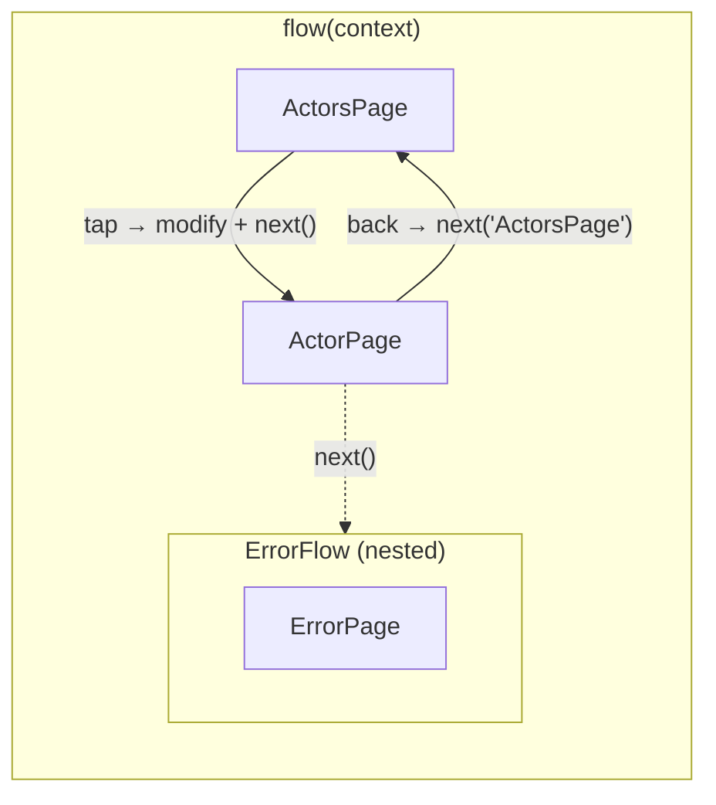

<div align="center">

# 🌊 vue3-flow

**Build page flows in Vue 3 as plain objects, without extra routes.**

Describe a sequence of screens (wizard steps, list → detail, onboarding) in one
function, then move between them with `next()`.

[](https://www.npmjs.com/package/vue3-flow)
[](https://www.npmjs.com/package/vue3-flow)
[](https://bundlephobia.com/package/vue3-flow)

[](LICENSE)

</div>

---

## Table of contents

- [Why](#-why)
- [Installation](#-installation)
- [Quick start](#-quick-start)
- [Core concepts](#-core-concepts)
- [API](#-api)
  - [Components](#components)
  - [Flow context](#flow-context)
  - [Page options](#page-options)
  - [Nested flow options](#nested-flow-options)
  - [Hooks](#hooks)
  - [Helpers](#helpers)
  - [`registerFlowTree`](#registerflowtree-experimental)
- [Running the playground](#-running-the-playground)
- [License](#-license)

## 💡 Why

Some screens belong together and don't each need their own URL: checkout
steps, a list with a detail view, a sign-up wizard. Giving every step its own
route makes them harder to manage, and `v-if` chains get messy fast.

With **vue3-flow** you describe the whole sequence in one place:

- pages are **objects** with `component`, `props`, `events` and `show`
- one **flow function** registers the pages and wires their events
- **`next()`** moves to the next page or jumps to a named one
- **`modify()`** changes another page's props before you go to it
- flows can be **nested**, with async (lazy) components supported out of the box

## 📦 Installation

```bash
npm install vue3-flow
```

`vue` 3.x is a peer dependency.

## 🚀 Quick start

**1. Describe the flow**

```js
// flows/actors.js
import ActorsPage from './ActorsPage.vue'
import ActorPage from './ActorPage.vue'

export default (context) => {
  context.addPage('ActorsPage', {
    component: ActorsPage,
    events: {
      // ActorsPage emits "tap" with the chosen actor
      tap: (actor) => {
        context.modify('ActorPage', (page) => {
          page.props.actor = actor
          return page
        })
        context.next() // → ActorPage
      },
    },
  })

  context.addPage('ActorPage', {
    component: ActorPage,
    events: {
      back: () => context.next('ActorsPage'),
    },
  })

  // Lazy-loaded page inside a nested flow
  context.addFlow('ErrorFlow', {
    flow: (context) => {
      context.addPage('ErrorPage', {
        component: () => import('./ErrorPage.vue'),
      })
    },
  })
}
```

**2. Render it**

```vue
<template>
  <FlowView :flow="actorsFlow" />
</template>

<script setup>
import { FlowView } from 'vue3-flow'
import actorsFlow from './flows/actors'
</script>
```

**...or mount it as a route component**

```js
import { FlowPageVue } from 'vue3-flow'
import actorsFlow from './flows/actors'

const routes = [
  { path: '/actors', component: FlowPageVue, props: { flow: actorsFlow } },
]
```

The first registered page is shown by default.

## 🧠 Core concepts



| Term     | Meaning                                                                    |
| -------- | -------------------------------------------------------------------------- |
| **Flow** | A function `(context) => void` that registers nodes                        |
| **Node** | One step of a flow: either a **page** or a nested **flow**                 |
| **Page** | A node that renders a Vue component with the given props and events        |
| **Next** | Moves the current node forward in the order nodes were added, or by name   |

## 📖 API

### Components

| Export        | Description                                                                         |
| ------------- | ----------------------------------------------------------------------------------- |
| `FlowView`    | Main component. Props: `flow` (required), `hooks`                                   |
| `FlowPageVue` | SFC that runs a flow. Use it as a route `component` with `props: { flow, hooks }`   |
| `FlowPage`    | Experimental render-function version of `FlowPageVue`                               |

Attributes you pass to the component that aren't props are available inside the
flow as `context.props`.

### Flow context

The `context` object that every flow function receives:

| Member                    | Description                                                                                              |
| ------------------------- | -------------------------------------------------------------------------------------------------------- |
| `addPage(name, options)`  | Registers a page node and returns it. Throws if a node with that name exists                             |
| `addFlow(name, options)`  | Registers a nested flow node and returns it                                                              |
| `next(name?)`             | No argument: go to the next node (stays on the last one). With a string: jump to that node, or throw if it doesn't exist |
| `modify(name, callback)`  | `callback(options) => options`: receives the node's options, and its return value is merged back       |
| `current()`               | Name of the current node                                                                                 |
| `nodes`                   | Reactive map of all registered nodes                                                                     |
| `store`                   | Reactive object for sharing state between pages of this flow                                             |
| `props`                   | Attributes passed to the flow component (`useAttrs()`)                                                  |

### Page options

```js
context.addPage('Step1', {
  component: Step1,          // required: component object or () => import('./Step1.vue')
  props: { title: 'Hello' }, // passed to the component
  events: { done: () => {} },// listeners for events the component emits
  show: true,                // set to false to hide the page
})
```

### Nested flow options

```js
context.addFlow('Payment', {
  flow: (ctx) => { /* register pages */ }, // required
  props: {},   // available inside as ctx.props
  events: {},
  show: true,
})
```

### Hooks

`FlowView`, `FlowPageVue` and `FlowPage` accept a `hooks` object with optional
`__before__` and `__after__` functions. They get the same `context` and run
before and after the flow function. They're useful for shared setup, such as
filling `context.store`.

```vue
<FlowView :flow="flow" :hooks="{ __before__: (ctx) => (ctx.store.user = user) }" />
```

### Helpers

| Export                   | Description                                                                                       |
| ------------------------ | ------------------------------------------------------------------------------------------------- |
| `defineAction(actions)`  | Returns `dispatch(name, ...args)` that calls `actions[name]`. Throws on unknown actions          |
| `defineEmit(validators)` | Returns a composable. Call it in `setup` to get an `emit` that checks events before emitting     |
| `getEmit()`              | Returns `emit` of the current component instance                                                  |

```js
const dispatch = defineAction({
  save: (data) => api.save(data),
})
dispatch('save', form)
```

### `registerFlowTree` (experimental)

Builds `vue-router` route records from a tree of flows. Each flow becomes a
route rendered by `FlowPageVue`. Keys like `__before__` and `__after__` become
hooks shared by all flows at that level.

```js
import { registerFlowTree } from 'vue3-flow'

const routes = registerFlowTree({
  main: {
    flows: {
      signup: signupFlow,   // → /signup
      checkout: checkoutFlow, // → /checkout
      __before__: (ctx) => { /* shared setup */ },
    },
  },
})
```

## 🧪 Running the playground

The repo includes a small playground with example flows in `src/cases`. Each
`src/cases/*/flow.js` is served at `/case1`, `/case2`, and so on.

```bash
git clone https://github.com/mredwardlik/vue3-flow.git
cd vue3-flow
npm install
npm start          # → http://localhost:8000/case1
npm run build      # build the library into build/
```

## 📄 License

[MIT](LICENSE) © Eduard Lik
